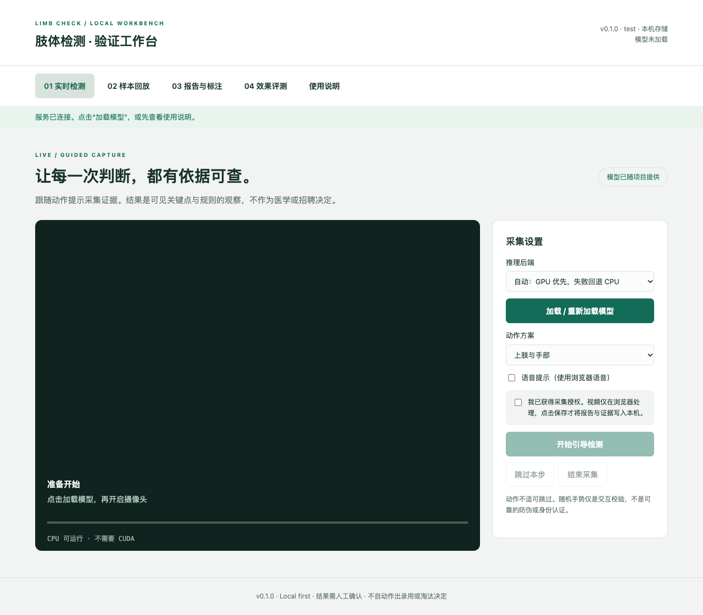

# 肢体检测验证工作台

一个**可直接运行、采集、回放、人工标注、评测和持续迭代的本机项目**。默认没有 Python 第三方依赖，不需要独立 GPU，不需要模型 API 密钥。MediaPipe 模型及浏览器运行库已随仓库提供。

它提供可见关键点与规则的观察结果，不是经过临床或招聘场景验证的完整性鉴定系统。**程序运行测试通过不等于真实检测准确率达标。** 不自动决定录用或淘汰。



## 1. 三步启动

需要 Python **3.10+**；建议 Chrome / Edge。日常使用不需要 Node.js、npm、PyTorch、CUDA 或 `pip install`。

```bash
git clone https://github.com/bwz5566/limb_check_gpt.git
cd limb_check_gpt
python3 server.py
```

Windows 可用 `py -3 server.py` 或双击 `start.bat`。macOS 可在终端运行 `sh start.command`。

打开 **http://localhost:8000** → 点击“加载模型” → 等待实际后端（人体 CPU/GPU、手部 CPU/GPU）显示 → 选择动作方案 → 勾选授权 → 开始检测。加载失败时选“强制 CPU”重试。不要双击 `index.html`，必须通过服务器访问。

端口占用：`python3 server.py --port 8010`。停止：终端 `Ctrl+C`。

## 2. 交付能力与边界

| 能力 | 当前实现 | 如何验证 |
| --- | --- | --- |
| 摄像头引导 | 上肢、全身、手部三种方案；保持判定、超时、跳过、中断报告 | 真人按步骤执行；详见测试文档 |
| 本地推理 | MediaPipe Pose + Hands；GPU 自动回退 CPU，可强制 CPU | 看实际运行后端；运行空白自检 |
| 四肢观察 | 可见度、入框、二维左右长度比 | 使用人工标注的正常、遮挡、透视和真实异常样本 |
| 手指观察 | 伸展状态、长度比例、弯曲与遮挡不确定性 | 真实缺失样本与遮挡样本分开统计 |
| 美甲提醒 | 手背指甲估计区域与皮肤的 Lab 色差 | 手背朝前并显式开启；透明/裸色甲可能漏检 |
| 纹身、疤痕、发色 | 可选视觉模型观察；未配置时为未评估 | 无内置专用模型；未经真实效果评测 |
| 样本回放 | 多图片/多视频顺序分析；视频最多 60 个均匀分布抽帧 | 同一样本固定配置重复运行 |
| 报告 | 指标、规则版本、证据、动作状态；JSON、打印 PDF | 下载或保存后重新打开 |
| 持久化 | SQLite；显式保存，按环境隔离；不存原视频 | 重启后报告与标签仍存在 |
| 人工标注 | 六项逐项标签、数据集、匿名受试者 ID、备注、修改历史 | 保存标签后查看评测 |
| 效果评测 | TP/TN/FP/FN、覆盖率、准确率、召回率、全阳性检出率、误报率 | 按数据集/引擎/规则版本筛选 |
| 扩展 | 模型适配器、纯规则模块、动作注册、统一报告/API | 见扩展指南 |
| 软件自检 | Python API/存储/评测测试 + Node 规则/流程测试 + 文件校验 | `python3 scripts/verify.py` |

**尚未交付**：公网多用户权限系统、身份核验、可靠防回放/防注入、服务器视频推流、GPU 模型部署、训练管线、HR 集成、已验证的准确率。生产配置表示独立配置与数据目录，**不代表可直接公网生产部署**。

## 3. 推荐的首次体验（无摄像头也可）

1. 启动后选择强制 CPU，加载模型。
2. 打开“样本回放”，点击“运行空白画面自检”。应显示四肢和手指无法判断、其他项目未评估。
3. 勾选保存授权，保存报告；进入“报告与标注”，查看记录。
4. 给自检报告添加标签，再打开“效果评测”：模拟报告仍被排除，不能生成虚假的准确率。
5. 导入有授权的真实图片/视频。手背样本才开启美甲色差，完成后保存并标注。
6. 在同一数据集上按规则版本比较结果。不能把“藏手指”当成真实缺指样本。

随附 `samples/blank.png` 和 `samples/blank.mp4` 仅供文件导入与解码测试，导入时勾选“模拟 / 合成样本”。没有未经授权的人体样本，也没有内置的真实异常样本。

## 4. 配置与可选模型

公共模板位于 `config/development.json`、`test.json`、`production.json`。敏感信息按环境明文写入对应 `*.local.json`，覆盖模板；这些本地配置被 Git 忽略，HTTP 也不提供访问。

例如新建 `config/development.local.json`：

```json
{
  "vlm": {
    "enabled": true,
    "base_url": "http://127.0.0.1:11434/v1",
    "model": "填写你实际部署的视觉模型名",
    "api_key": "填写该服务要求的密钥，无鉴权可留空",
    "timeout_seconds": 45
  }
}
```

需要自己已有一个支持图片输入的兼容接口。项目不会自动下载或部署视觉大模型。配置后重启；页面需再次勾选发送授权，才发送证据。默认任何样本都不会被发送到外部模型。

```bash
python3 server.py --env test        # 默认 8001；data/test
python3 server.py --env production  # 默认 8080；data/production，仍仅本机
```

规则集中在 `config/rules.json`。修改阈值时**同时更新 version**，重启服务并重新加载网页模型。

## 5. 项目结构

```text
server.py                本地服务入口
backend/
  config.py              分环境配置、公用枚举、公开配置白名单
  http.py                HTTP API、静态文件、安全边界
  validation.py          报告、图片、人工标签校验
  store.py               SQLite 保存、幂等、标注历史
  evaluation.py          指标与分母定义
  vlm.py                 可选模型适配、固定提示词、结构校验
web/
  index.html / style.css  工作台界面
  src/app.js             页面操作、媒体输入、报告与标注
  src/engine.js          MediaPipe 适配器及可视化
  src/domain.js          可单测的几何规则、聚合、仲裁、报告
  src/workflow.js        动作方案与状态机
  models/                人体与手部模型（已提供）
  vendor/                本地运行库、WASM、第三方许可
config/                  环境模板、规则、资源 SHA-256 清单
scripts/                 自检、离线评测、备份
tests/                   API、存储、规则、动作状态机测试
samples/                 无个人数据的测试素材
docs/                    使用、架构、扩展、接口、评测、部署文档
data/                    本地运行数据（不提交）
output/                  测试产物（不提交）
```

## 6. 软件自检与效果验收

完整开发自检额外需要 **Node.js 20+**，无需 `npm install`：

```bash
python3 scripts/doctor.py
python3 scripts/verify.py
```

评测已保存并人工标注的真实样本：

```bash
python3 scripts/evaluate.py --dataset validation-v1 --rule-version rules-1.0.0 --output output/evaluation.json
python3 scripts/evaluate.py --manifest path/to/manifest.jsonl --dataset validation-v1
```

一致性备份（包括证据与标注历史）：

```bash
python3 scripts/backup.py --env development --output output/backup-001.sqlite3
```

GitHub Actions 对 Linux、Windows、macOS 运行软件自检。浏览器和真人效果验收步骤及实测记录见以下文档。

## 7. 详细文档

- [用户操作手册](docs/USER_GUIDE.md)：启动、采集、回放、标注、故障排查。
- [架构与数据流](docs/ARCHITECTURE.md)：各模块职责与设计取舍。
- [扩展与需求迭代](docs/EXTENDING.md)：换模型、加动作、改阈值、加检测项。
- [API 与报告契约](docs/API.md)：接口、状态、版本及错误处理。
- [数据集与效果评测](docs/EVALUATION.md)：标签、指标、分母和验收方法。
- [配置与部署](docs/DEPLOYMENT.md)：三环境、离线运行、数据和备份。
- [软件测试与人工验收](docs/TESTING.md)：可执行命令与验收清单。
- [交付验证记录](docs/VALIDATION.md)：本次实际执行结果与未验证项。
- [版本计划](docs/ROADMAP.md)：当前边界与后续演进。
- [第三方资源说明](THIRD_PARTY_NOTICES.md)：原始资源、许可与哈希。

## 8. 维护约定

不批量删除文件；数据与本地密钥不提交 Git。改变模型、提示词、阈值或数据格式都要记录版本并跑回归。新增能力必须说明“未评估”“无法判断”和失败路径，禁止缺少模型时返回模拟的成功结果。详见 [CONTRIBUTING.md](CONTRIBUTING.md)。
