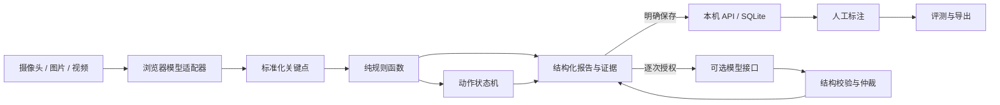

# 架构与数据流

## 当前边界

本版本是本机单用户验证工作台。选择 Python 标准库和原生 ES 模块，是为了新电脑无需构建前端、安装 GPU 软件或下载模型就能启动。Node 仅用于开发单元测试。没有以微服务占位文件冒充已完成服务。

## 模块职责

- `engine.js`：模型加载、输入缩放、关键点归一化、图像颜色计算、证据与叠加图。模型对象不泄漏到数据库。
- `domain.js`：几何计算、六项结果、帧聚合、模型状态仲裁、报告构造。可在 Node 中无 DOM 测试。
- `workflow.js`：动作方案注册、连续保持、超时与跳过、站立基准和手掌方向。与页面分离。
- `app.js`：输入设备和文件生命周期、UI、API 请求、报告保存。浏览器关闭时释放摄像头。
- `http.py`：请求边界、接口分发与 web 目录白名单。不会静态提供项目根目录。
- `validation.py`：报告和标签契约；图片只允许内嵌 PNG/JPEG。
- `store.py`：SQLite 事务、run_id 幂等、人工标注最新值和历史。
- `evaluation.py`：覆盖率与条件指标。模拟样本排除、空分母 null、版本混用提示。
- `vlm.py`：固定服务端提示词、图片输入、超时、严格 JSON、低置信度处理。不接受客户端任意提示词或模型地址。

## 模型调用

随附 Pose Full、Hand Landmarker 两个模型。采用 IMAGE 模式处理相机和回放抽帧，避免不同视频的时间戳状态互相污染。代价是没有利用 VIDEO 模式的跟踪优化，CPU 性能应在目标设备上测量。每帧最长边缩放到 960；关键点转换为像素坐标后计算长度/角度，避免宽高比直接污染几何距离。

摄像头默认每至少 100 ms 尝试推理一次，推理同步运行在浏览器主线程；实际速度以报告耗时为准。模型创建 GPU 失败才自动回退；已创建后运行失败会停止并提示，可手动强制 CPU 重载。

## 聚合与动作状态

视频统计所有实际抽到的帧：出现 flag 保留疑点；没有 flag 但可判断比例低于 80% 则 uncertain。一个正常帧不能掩盖其他大量无法判断的帧。

引导检测每个步骤结束保留一个分析帧，结构评估仅使用适合的步骤：全身远景不评价手指；手部近景不评价全身；握拳和随机手势不评价手指结构。步骤没有完成会影响相关类别的最终状态。截图最多 6 张，报告中的步骤状态与结构观察分别展示。

L2 只比较类别状态，状态相同不代表具体解剖部位或医学事实一致。单独的外观模型结果标注来源与未经效果评测。未来精确到每指的仲裁，应升级 finding 契约而不是扩展字符串解析。

## 数据与权限

原文件留在浏览器，未点击保存的数据仅存在内存。保存后结构化结果与 Base64 证据写入 SQLite，便于完整本机备份。以单用户实验规模为目标，不适合无限量图片仓库；未来需要规模化时将证据迁入对象存储。

HTTP 仅监听回环地址、校验 Host、写入需要 CSRF token、限制 Origin 和请求大小。token 不是多用户认证。配置文件在静态目录之外，公开配置采用字段白名单。CSV 对公式前缀转义。

数据库版本为 1；未来修改表结构需显式增量迁移并保留备份。当前不提供批量删除功能，也不自动清理用户证据。
