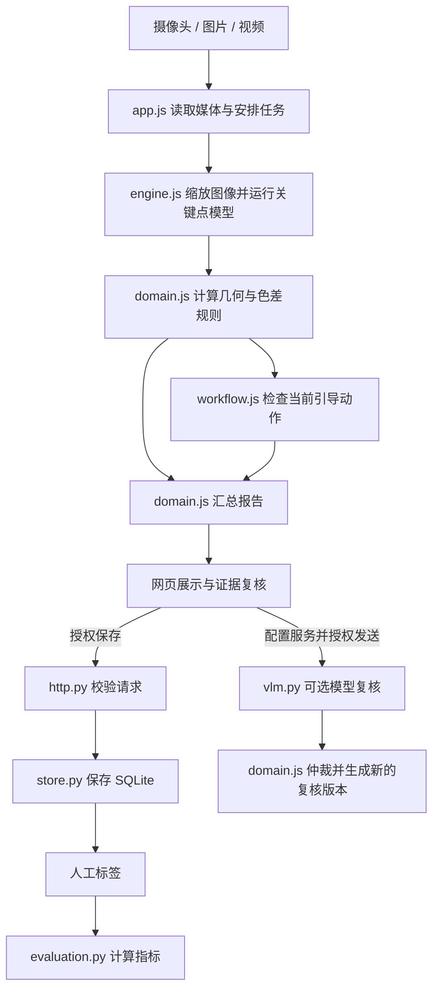

# 从使用到读懂代码：术语、检测逻辑与维护详解

本文面向希望运行项目、理解判断依据，并继续追加或替换需求的读者。无需先熟悉机器学习、JavaScript 或数据库。

**适用基线：项目 0.1.0、规则 `rules-1.0.0`。核对日期：2026-10-25。** 文中“当前实现”均指仓库实际代码；“建议”“示例改造”表示后续工作。调整模型、规则或数据格式后，应同步修改本文。

本文解释的是工程和观察规则，不提供已验证的真实检测准确率。随附模型负责预测人体和手部关键点；手指、四肢、美甲结果主要来自这些点和像素上的人工规则。

## 阅读导航

- [1. 先回答最容易困惑的问题](#part-1)
- [2. 术语表](#part-2)
- [3. 项目分层与完整数据流](#part-3)
- [4. 启动、模型加载与配置](#part-4)
- [5. 读源码需要的语法](#part-5)
- [6. 图像、坐标与关键点](#part-6)
- [7. 几何计算](#part-7)
- [8. 单帧判断：先看输入是否可用](#part-8)
- [9. 四肢比例规则](#part-9)
- [10. 手指规则逐步演算](#part-10)
- [11. 美甲色差逐步演算](#part-11)
- [12. 摄像头动作状态机](#part-12)
- [13. 视频抽帧与批量处理](#part-13)
- [14. 多帧汇总与完整报告](#part-14)
- [15. 可选视觉模型与结果仲裁](#part-15)
- [16. HTTP 接口与数据校验](#part-16)
- [17. SQLite 保存、幂等与标注](#part-17)
- [18. 效果评测与完整算例](#part-18)
- [19. 配置参数速查](#part-19)
- [20. 超时、异常与资源释放](#part-20)
- [21. 按真实操作追踪代码](#part-21)
- [22. 追加需求与替换模型](#part-22)
- [23. 验证、排错和阅读检查](#part-23)

建议先读第 1、3、8、14、18 节，理解系统输出；然后读第 6–12 节理解算法；维护项目时再结合第 16、17、19、22 节。

<a id="part-1"></a>
## 1. 先回答最容易困惑的问题

### 1.1 `python3 server.py` 到底启动了什么？

它启动一个本机 HTTP 服务，让浏览器能够打开页面、读取随附模型、保存报告、查询评测。主要推理发生在浏览器中，而不是 Python 里。

- Python：提供网页和模型文件，读写 SQLite，计算评测指标，按配置转发可选模型请求。
- 浏览器：读取摄像头或用户选择的文件，加载 MediaPipe，执行关键点推理、规则判断和动作引导。
- 可选模型服务：只有配置并启用、且用户授权复核时，才接收选中的证据图。

因此，终端显示“服务启动”只证明 HTTP 服务可用。还需要在网页点击“加载模型”，随后用图片、视频或摄像头验证实际推理。

### 1.2 模型下载好了吗？为什么没有独立 GPU 也能用？

以下资源已随仓库提供：

| 文件/目录 | 用途 |
| --- | --- |
| `web/models/pose_landmarker_full.task` | 人体关键点模型 |
| `web/models/hand_landmarker.task` | 手部关键点模型 |
| `web/vendor/vision_bundle.mjs` | 浏览器使用的 MediaPipe JavaScript 接口 |
| `web/vendor/wasm/` | 模型运行所需的 WebAssembly 资源 |

浏览器通过本机服务器读取它们。默认 `AUTO` 会对人体和手部模型分别尝试 GPU，失败后尝试 CPU；也可以明确选择 CPU。这里不要求安装 CUDA，也不要求有 NVIDIA 独立显卡。浏览器可用的 GPU 后端与“是否有独立显卡”不是同一个问题，应以页面显示的实际后端为准。

**已提供的是关键点模型；没有随仓库提供纹身、疤痕、发色专用模型，也没有自动部署视觉大模型。** 当前运行路径不包含模型训练。

### 1.3 “识别出五个指尖”为什么不等于“证明有五根完整手指”？

模型输出的是对图像中关键点位置的预测。遮挡、模糊或与训练数据不同的情况，都可能使预测出错。模型也可能在不可见的位置预测出点。

后续代码只知道“这些坐标是什么”，并没有直接获得真实解剖结构。当前规则能提示比例疑点、指出输入不足，但不能把模型预测当作真实完整性的证明。

### 1.4 四种结果必须分开理解

| 代码 | 页面含义 | 例子 | 不能解释成 |
| --- | --- | --- | --- |
| `clear` | 未见规则疑点 | 可用画面中的比例没有越过阈值 | 已证明完整、完全没有异常 |
| `flag` | 发现疑点 | 左右前臂的二维长度比越界 | 已确诊缺失或异常 |
| `uncertain` | 无法判断 / 需复核 | 遮挡、弯曲、输入不足或模型分歧 | 默认正常或默认异常 |
| `not_assessed` | 未评估 | 未开启美甲；未配置外观模型 | 检测后没有发现问题 |

例如“一只手没被模型检测到”会导致 `uncertain`，不会直接判定那只手不存在。

<a id="part-2"></a>
## 2. 术语表

### 2.1 模型和图像术语

| 术语 | 通俗解释 | 本项目的位置或例子 |
| --- | --- | --- |
| 模型 / Model | 从训练数据中形成的预测程序及参数 | 两个 `.task` 文件 |
| 权重 / Weights | 模型训练得到的数值参数 | 本项目使用现成资源，不训练权重 |
| 训练 / Training | 用数据调整模型参数 | 当前未实现 |
| 推理 / Inference | 用已有模型处理新的输入 | `model.detect(canvas)` |
| MediaPipe | 本项目使用的人体、手部关键点工具库 | `engine.js` 的导入语句 |
| Landmark / 关键点 | 预测的关节、指尖等位置 | 手部点 0 表示手腕 |
| Pose | 人体姿态关键点结果 | `poses` 数组 |
| Handedness | 左手或右手的分类结果 | `hands[i].side` 与 `score` |
| Visibility / 可见度 | 模型给出的关键点可见程度信号 | 人体点的 `v`，门槛 0.6 |
| Confidence / 置信度 | 某项预测的分数，含义取决于具体输出 | 左右手分类分数与 VLM 自报分数不能混用 |
| ROI | Region of Interest，感兴趣的局部区域 | 估计指甲附近的小方块；代码没有独立指甲分割模型 |
| 像素 / Pixel | 图像里的一个颜色位置 | 处理图像上的 `x`、`y` |
| 归一化坐标 | 用相对比例表达位置，通常以图宽、图高为尺度 | `nx=0.5` 表示横向一半位置 |
| RGB | 用红、绿、蓝三个通道表达颜色 | 图像读取值通常为 0–255 |
| Lab | 用亮度 L、两条颜色轴 a/b 表达颜色 | 美甲色差使用的颜色空间 |
| ΔE / Delta E | 两个 Lab 颜色的距离 | 本项目使用简单欧氏距离，不是 ΔE2000 |
| 启发式 / Heuristic | 人工制定的近似规则 | “色差大于 22 提示疑点” |
| 阈值 / Threshold | 触发条件的分界数值 | `minHandPixels=65` |
| VLM | Vision-Language Model，可接收图像和文本的视觉语言模型 | 可选复核服务 |
| Prompt / 提示词 | 发给模型的任务描述 | `backend/vlm.py` 中固定构造的文本 |
| Token | 模型处理文本的计量单位，不等于一个汉字或单词 | `max_tokens=1600` 限制输出长度预算 |

### 2.2 工程和数据术语

| 术语 | 通俗解释 | 本项目的位置或例子 |
| --- | --- | --- |
| 前端 / Frontend | 在浏览器中运行的页面和逻辑 | `web/` |
| 后端 / Backend | 服务器端处理请求的程序 | `backend/` |
| 原生 JavaScript | 直接使用浏览器语言和接口 | 当前没有 React/Vue 构建流程 |
| WASM / WebAssembly | 浏览器可执行的编译后程序格式 | 本地推理运行库 |
| Delegate / 执行后端 | 选择模型计算交给 CPU 还是 GPU | `AUTO`、`CPU`、`GPU` |
| Canvas | 浏览器中的像素画布 | 缩放输入、取色、画关键点 |
| Frame / 帧 | 视频或摄像头在一个时刻的图像 | 一次 `analyze()` 处理一帧 |
| Step / 步骤 | 一个需要保持的引导动作 | 张手、翻手背、握拳 |
| Report / 报告 | 一次分析的汇总记录 | 包含结果、指标、证据和版本 |
| State machine / 状态机 | 明确记录当前阶段及切换条件的程序 | `Workflow` |
| Adapter / 适配器 | 把某个模型的输出转成项目约定格式 | `MediaPipeEngine` |
| 纯函数 | 不依赖页面、数据库等外部状态的计算 | 几何规则便于单独测试 |
| API | 程序之间调用的约定入口 | `/api/reports` |
| HTTP | 浏览器与服务器通信的协议 | `GET` 读取、`POST` 提交 |
| JSON | 用对象、数组、字符串等表达结构数据的文本格式 | 配置与报告 |
| JSONL | 每一行是一个完整 JSON 对象 | 导出的评测清单 |
| Schema / 数据结构契约 | 约定有哪些字段、类型和允许值 | `schema_version=1.0` |
| SQLite | 将结构数据存入本地文件的数据库 | `workbench.sqlite3` |
| 主键 / Primary key | 唯一标识一条数据库记录的字段 | `reports.id` |
| 幂等 / Idempotent | 相同操作重复执行，不额外产生同一份记录 | 同一个 `run_id` 重复保存 |
| 事务 / Transaction | 一组数据库操作共同成功或共同回滚 | 更新最新标签并追加修改历史 |
| WAL | Write-Ahead Logging，SQLite 的预写日志模式 | 写入过程中可能出现 `-wal` 文件 |
| UUID | 用于生成低碰撞概率标识符的格式 | 浏览器生成 `run_id` |
| SHA-256 | 对文件字节计算固定长度摘要的方法 | 校验模型文件是否与清单一致 |
| Base64 / Data URL | 把二进制图像编码进文本的方法 | 报告里的 `data:image/jpeg;base64,...` |
| CI | Continuous Integration，提交后自动运行检查 | GitHub Actions 三系统测试 |
| 回归测试 | 修改后检查已有行为是否仍正确 | `scripts/verify.py` |
| Mock / Stub | 用受控替代对象验证软件分支 | 模型接口测试，不代表真实模型准确率 |

### 2.3 评测术语

“阳性”在本文仅指人工标签为 `flag`，不是医学诊断；“阴性”指人工标签为 `clear`。

| 术语 | 通俗解释 |
| --- | --- |
| Ground truth / 参考标签 | 人工确认、用于比较的标签；标签本身也需要质量控制 |
| TP / 真阳性 | 人工标为 `flag`，系统也判 `flag` |
| TN / 真阴性 | 人工标为 `clear`，系统也判 `clear` |
| FP / 假阳性 / 误报 | 人工标为 `clear`，系统判 `flag` |
| FN / 假阴性 / 漏报 | 人工标为 `flag`，系统判 `clear` |
| Abstention / 弃权 | 对已有确定人工标签的记录，系统没有给出 `clear/flag` |
| Coverage / 可判断覆盖率 | 有效标注中，系统给出确定判断的比例 |
| Accuracy / 准确率 | 确定判断中，判断正确的比例 |
| Recall / 召回率 | 在本项目的确定判断口径下，人工阳性被检出的比例 |
| 数据泄漏 | 本应独立的验证信息进入调参过程，使效果估计过于乐观 |

指标的精确分母见第 18 节，不能只凭名称比较不同系统。

<a id="part-3"></a>
## 3. 项目分层与完整数据流



图片、视频回放不经过动作完成判定。上图中的动作分支用于摄像头引导。

| 源码 | 主要职责 | 阅读时先找 |
| --- | --- | --- |
| [server.py](../server.py) | 解析启动参数、启动与关闭服务 | `main()` |
| [backend/config.py](../backend/config.py) | 合并环境配置、公开字段白名单 | `load_config()`、`public_config()` |
| [web/src/app.js](../web/src/app.js) | 按钮、媒体、任务、报告、保存和复核 | `loadModel()`、`startCamera()`、`analyzeFile()` |
| [web/src/engine.js](../web/src/engine.js) | 调用模型、坐标转换、取色、画图 | `init()`、`analyze()`、`nails()` |
| [web/src/domain.js](../web/src/domain.js) | 与页面无关的规则与报告计算 | `analyzeFrame()`、`aggregate()` |
| [web/src/workflow.js](../web/src/workflow.js) | 动作顺序、保持、超时、基准 | `check()`、`update()`、`complete()` |
| [web/src/async.js](../web/src/async.js) | 有期限的异步等待与迟到结果处理 | `deadline()` |
| [backend/http.py](../backend/http.py) | 路由、静态文件、请求限制 | `do_GET()`、`do_POST()` |
| [backend/validation.py](../backend/validation.py) | 报告、标签、图片格式检查 | `validate_report()`、`image_data()` |
| [backend/store.py](../backend/store.py) | 保存报告和标签历史 | `save()`、`annotate()` |
| [backend/evaluation.py](../backend/evaluation.py) | 筛选记录、计数、计算指标 | `evaluate()` |
| [backend/vlm.py](../backend/vlm.py) | 可选模型请求与返回值校验 | `review()`、`parse_output()` |

分层的目的很具体：改按钮不用改计算公式；改规则不用启动真实摄像头才能测试；换模型尽量在适配器内完成；换数据库不应改变状态含义。

<a id="part-4"></a>
## 4. 启动、模型加载与配置

### 4.1 Python 入口逐句理解

`server.py` 的流程可以概括为：

```python
# 说明性摘录：省略参数定义和异常处理，完整实现见 server.py。
args = parser.parse_args()
config = load_config(args.env)
server = create_server(config)
server.serve_forever()
```

1. `parse_args()` 把 `--env test` 等命令行文字转成属性。
2. `load_config()` 读取环境模板、同环境本地覆盖文件和规则。
3. `create_server()` 建立数据库、产生本次服务的请求令牌，并绑定地址和端口。
4. `serve_forever()` 持续等待请求。`Ctrl+C` 触发退出，`finally` 关闭服务。
5. 文件末尾 `if __name__ == "__main__"` 表示直接执行此文件时才调用入口；被其他模块导入时不会自动启动服务。
6. `raise SystemExit(main())` 将返回值传给操作系统，`0` 表示成功退出，非零表示失败。

### 4.2 配置覆盖次序

以开发环境为例：

```text
config/development.json
    ↓ 用相同键覆盖
config/development.local.json（存在才读取）
    ↓ 添加环境名，并统一读取
config/rules.json
    ↓ 若命令行提供 --port，再覆盖端口
最终服务配置
```

`vlm` 这样的字典使用一层 `update()` 合并。例如本地文件仅写 `{"vlm":{"enabled":true}}`，模板里的 `timeout_seconds` 仍保留。这不是任意深度的递归合并。

开发、测试、生产分别使用自己的 `*.local.json`，密码和密钥按环境以明文保存在这些本地文件中。它们在 `.gitignore` 中，不能推送到 GitHub。浏览器通过 `public_config()` 得到的白名单里没有密钥和模型服务地址。

### 4.3 浏览器初始化

`app.js` 底部先请求 `/api/config`，保存规则和 CSRF 令牌，然后等待用户加载模型。`loadModel()` 调用 `engine.init()`：

```javascript
const delegates = delegate === 'AUTO' ? ['GPU', 'CPU'] : [delegate];
```

这行是条件表达式：如果选 AUTO，按 GPU、CPU 顺序尝试；否则只尝试选中的那个后端。人体和手部模型各执行一次尝试流程，所以两者最后的后端可能不同。

模型使用 `runningMode: 'IMAGE'`。即使输入是摄像头或视频，项目也把每次获取的画面作为单帧交给模型，没有在这里启用 MediaPipe 的 VIDEO 模式。

<a id="part-5"></a>
## 5. 读源码需要的语法

本节用当前代码中的写法解释语法。片段用于阅读，不需要粘贴进项目重复添加。

### 5.1 JavaScript：数组、对象与函数

```javascript
const $ = selector => document.querySelector(selector);
```

`const` 定义一个不能重新赋值的变量名；`=>` 是箭头函数。`$` 在这里是作者自定义的函数名，不是 jQuery。`$('#notice')` 就是寻找页面中 `id="notice"` 的元素。

```javascript
const [a, b, , tip] = ids;
```

这是数组解构。若 `ids=[5,6,7,8]`，则 `a=5`、`b=6`、`tip=8`，中间空位跳过数字 7。被跳过的点仍参与手指总长度计算，只是不用于这里的角度计算。

```javascript
const point = p => ({ x: p.x * this.canvas.width, y: p.y * this.canvas.height,
                      nx: p.x, ny: p.y, v: p.visibility ?? 1 });
```

箭头后用 `({ ... })` 返回一个对象；括号避免把花括号误解成函数体。`??` 只在左侧是 `null` 或 `undefined` 时使用右侧值，因此 `visibility=0` 会保留为 0，不会变成 1。

```javascript
handedness[i]?.[0]?.categoryName || 'Unknown'
```

`?.` 表示“前面的值存在才继续访问”，防止缺项时直接抛异常。`||` 在左侧为假值时使用默认值。它与 `??` 的差别是：`0`、空字符串等也会触发 `||` 的默认值。

| 写法 | 含义 | 代码中的用途 |
| --- | --- | --- |
| `map(fn)` | 每项转换成一个新值 | 把归一化点转成像素点 |
| `filter(fn)` | 保留满足条件的项 | 取出比例短于阈值的手指 |
| `some(fn)` | 至少一项满足即为真 | 是否有点出画 |
| `every(fn)` | 每项都满足才为真 | 是否双手都握拳 |
| `reduce(fn, 0)` | 从 0 开始累计 | 三段手指长度相加 |
| `flat()` / `flatMap()` | 把一层嵌套数组展开 | 合并双手的十个指甲数据 |
| `...object` | 把对象字段展开到新对象 | 组合报告、指标 |
| `Object.entries(obj)` | 得到键和值组成的数组 | 遍历六项检查 |
| `Object.fromEntries(pairs)` | 从键值对数组构造对象 | 创建检查结果或人工标签 |
| `structuredClone(obj)` | 复制嵌套数据 | 保留独立的原始报告和规则快照 |
| `===` / `!==` | 严格相等 / 不相等 | 比较状态和数字，不做隐式类型转换 |

`{...frame}` 只做一层复制。当前 `maskFrame()` 另外深复制了 `checks`，避免改展示场景时意外修改原帧的检查结果。

### 5.2 `async`、`await` 和异常

```javascript
try {
  const result = await api('/api/review', options);
  // 成功后使用 result。
} catch (e) {
  // 失败时展示原因，保留原报告。
} finally {
  state.busy = false;
  controls();
}
```

`async` 函数返回 Promise，即“稍后成功或失败的结果”。`await` 等待这份结果，但并不自动把同步模型运算搬到后台线程。`catch` 处理异常，`finally` 无论成功失败都恢复按钮状态。

`state.busy` 是页面的任务占用标记，避免同时启动互相干扰的分析操作；它不是服务器的用户权限锁。

### 5.3 Python：导入、字典、上下文管理器

```python
from .config import CHECKS
```

点号表示从同一个包中的 `config.py` 导入。`CHECKS` 是六项检测的固定集合。

```python
annotation = row.get("annotation") or {}
label = annotation.get("labels", {}).get(key)
```

`dict.get()` 找不到键时返回默认值，避免未标注记录直接报错。这里最终可能得到 `None`，后续会按“未标注”计数。

```python
with self.connect() as db:
    db.execute("SELECT id FROM reports WHERE run_id=?", (report["run_id"],))
```

`with` 使用上下文管理器，在代码块退出时执行提交、回滚、关闭等清理逻辑。`?` 是 SQL 参数占位符，数据通过后面的元组单独传入；末尾的逗号让 `(value,)` 成为单元素元组。不要改成直接拼接用户输入的 SQL 字符串。

`@contextmanager` 是装饰器，使包含 `yield` 的函数能够用于 `with`。`yield db` 之前负责建立连接，之后及 `finally` 中负责收尾。

<a id="part-6"></a>
## 6. 图像、坐标与关键点

### 6.1 先缩放，再推理

`MediaPipeEngine.analyze()` 中：

```javascript
const scale = Math.min(1, 960 / Math.max(width, height));
```

最长边不超过 960，较小的输入不放大。例如 1920×1080 变为 960×540。之后规则使用的是这张处理图上的像素距离，不是原图距离。

`minHandPixels=65` 因而要求手腕到中指根部在**缩放后的图像**上至少约 65 像素。它不是要求原照片的手掌宽度大于 65 像素，也不是毫米。

### 6.2 两套坐标同时保留

| 字段 | 表示什么 | 例子 |
| --- | --- | --- |
| `nx`、`ny` | 模型输出的相对坐标 | `nx=0.25, ny=0.5` |
| `x`、`y` | 乘处理图宽高后的像素坐标 | 960×540 图中为 `(240,270)` |
| `v` | `visibility`，未提供时默认 1 | 主要用于人体点可见度门槛 |

图像原点在左上，向右 `x` 增大，向下 `y` 增大。因此“手腕高于鼻子”写成 `wrist.y < nose.y`。

当前规则没有使用真实世界坐标或深度 `z`。手臂伸向镜头时，图上的长度会缩短；这不能直接解释为真实手臂变短。

### 6.3 手部索引

| 手指 | 从根部到指尖的索引 |
| --- | --- |
| 拇指 | 1、2、3、4 |
| 食指 | 5、6、7、8 |
| 中指 | 9、10、11、12 |
| 无名指 | 13、14、15、16 |
| 小指 | 17、18、19、20 |

0 是手腕。`IDS` 保存上表，便于复用同一段循环。非拇指的根部、近端关节、远端关节常称 MCP、PIP、DIP；拇指结构名称不同，代码主要依赖编号。

`hands[i].side` 来自模型左右手分类，不通过屏幕左右位置推断人体左右。`hands[i].score` 也来自这项分类，**不是“手完整的概率”**。当前 `minHandScore` 实际筛选的是这个分数，名字不能代替真实字段含义。

### 6.4 人体索引

| 身体位置 | 左侧 | 右侧 |
| --- | --- | --- |
| 肩 | 11 | 12 |
| 肘 | 13 | 14 |
| 腕 | 15 | 16 |
| 髋 | 23 | 24 |
| 膝 | 25 | 26 |
| 踝 | 27 | 28 |

`BODY` 包含这 12 个点。鼻子编号 0 用于上举比较，但不在当前 `BODY` 的可见度门槛列表中；读代码时要注意“用了某个点”和“检查过该点质量”并不总是同一回事。

<a id="part-7"></a>
## 7. 几何计算

### 7.1 两点距离

```javascript
export const distance = (a, b) => Math.hypot(a.x - b.x, a.y - b.y);
```

`Math.hypot(dx,dy)` 计算 `sqrt(dx²+dy²)`。例如 A=(10,20)、B=(13,24)，距离为 `sqrt(3²+4²)=5` 像素。`export` 允许其他模块导入此函数。

### 7.2 三点夹角

`angle(a,b,c)` 以 **b 为顶点**，计算向量 `a-b` 和 `c-b` 的夹角：

```text
余弦 = 两向量点积 / 两向量长度之积
角度 = acos(余弦) × 180 / π
```

“点积”就是对应坐标相乘后相加。`acos` 是反余弦，输出弧度，乘 `180/π` 转成角度。三点拉成直线且 b 在中间时约为 180°；弯成直角时约为 90°。

代码把余弦限制到 `[-1,1]`，防止浮点误差出现 1.00000001 导致无效结果。分母小于 `1e-6` 时返回 0；`1e-6` 即 0.000001，是除零保护，不是物理测量精度。

### 7.3 为什么经常用比例

人靠近镜头，像素长度通常整体变大。使用“手指长度 / 中指长度”可以减弱整体缩放的影响。但不同部位朝向不同、透视不同，比例依然会变；比例不自动解决姿态问题。

<a id="part-8"></a>
## 8. 单帧判断：先看输入是否可用

入口：[domain.js 的 `analyzeFrame()`](../web/src/domain.js)。一开始六项都为 `not_assessed`，再根据当前输入覆盖有执行条件的项目。

### 8.1 光照检查

图像另缩小为 64×36，每像素用下面的加权值估计亮度，再取平均：

```text
亮度 ≈ 0.299R + 0.587G + 0.114B
```

平均亮度小于 45 或大于 225 时，四肢和手指设为 `uncertain`；若启用了美甲，美甲也设为 `uncertain`，函数直接返回。45 和 225 本身不触发这两个严格不等式。

这只是整张图平均亮度，没有检查每个手指的局部曝光、运动模糊或对焦。背景很亮而手很暗，仍可能通过此门槛。

### 8.2 入框检查

```javascript
p.nx > 0.015 && p.nx < 0.985 && p.ny > 0.015 && p.ny < 0.985
```

关键点需要离图像边缘留出约 1.5% 的余量。等于边界也不通过。此判断只看关键点，不能证明手指轮廓、衣物边缘等全部入框。

### 8.3 身体和手部分开检查

| 项目 | 主要条件 |
| --- | --- |
| 四肢 | 恰好一个人体；`BODY` 各点可见度至少 0.6，且入框 |
| 手指 | 没有检测到多人；恰好两只手；左右手分类分数至少 0.5；所有手部点入框；手掌尺度至少 65 像素 |
| 美甲 | 启用该项，并满足手部条件、十指伸展、十个取色结果 |

手部近景可能没有人体姿态结果，所以手指规则允许 `poses.length=0`；`poses.length>1` 才因归属问题拒绝。当前适配器最多请求两个姿态、两只手，并不是完整的人群计数系统。

<a id="part-9"></a>
## 9. 四肢比例规则

通过输入门槛后，分别比较左右同类段：

```text
上臂：左肩→左肘 / 右肩→右肘
前臂：左肘→左腕 / 右肘→右腕
大腿：左髋→左膝 / 右髋→右膝
小腿：左膝→左踝 / 右膝→右踝
```

比值先保留两位小数，再判断是否小于 0.75 或大于 1.33。任意一段越界，本帧四肢结果为 `flag`；否则为 `clear`。

例如左前臂 120 像素，右前臂 100 像素，比值 1.20，不触发；左前臂 140，右前臂 100，比值 1.40，触发疑点。

这里有三个容易忽视的细节：

1. 比值方向是左 / 右，没有转换为“较短 / 较长”。
2. 比较的是舍入后的值。例如原始 0.746 舍入为 0.75，不会触发 `<0.75`。
3. 这是二维投影长度。转身、手臂指向镜头、关节定位错误，都可能使比值越界。

因此输出理由明确要求排除透视和姿态影响。当前没有用人体尺寸标定、相机参数或三维重建来证明真实长度。

<a id="part-10"></a>
## 10. 手指规则逐步演算

入口：`fingerMetrics()` 计算指标，`analyzeFrame()` 决定状态。

### 10.1 先求每根手指的折线长度

以食指 `[5,6,7,8]` 为例：

```text
食指长度 = distance(5,6) + distance(6,7) + distance(7,8)
```

对应实际代码：

```javascript
const lengths = IDS.map(ids => ids.slice(1).reduce(
  (sum, id, i) => sum + distance(points[ids[i]], points[id]), 0));
```

逐步展开：

1. `IDS.map` 依次处理五根手指。
2. `ids.slice(1)` 取 `[6,7,8]`。
3. 第一次 `i=0,id=6`，加 `distance(5,6)`。
4. 第二次 `i=1,id=7`，加 `distance(6,7)`。
5. 第三次 `i=2,id=8`，加 `distance(7,8)`。
6. `reduce` 的初始和为 0，返回三段之和。

此长度没有把手腕到手指根部的距离算进去。

### 10.2 用中指长度归一化

```text
某手指比例 = 该手指长度 / 中指长度
触发短缩指标的条件 = 比例 < fingerRef[该手指] × fingerShortFactor
```

当前默认值：

| 手指 | 参考比例 | 乘 0.6 后的门槛 |
| --- | --- | --- |
| 拇指 | 0.95 | 0.570 |
| 食指 | 0.88 | 0.528 |
| 中指 | 1.00 | 后续由单独规则覆盖 |
| 无名指 | 0.93 | 0.558 |
| 小指 | 0.72 | 0.432 |

例：中指折线长 100 像素，食指 50 像素，比例 0.50，低于 0.528，于是食指的内部 `short` 标记为 `true`。这还不是最终 `flag`，必须继续看伸展状态和输入质量。

与四肢不同，手指的 `short` 用未舍入比例计算；报告展示的 `ratio` 才保留两位。边界处不能仅凭展示小数逆推判断。

### 10.3 为什么中指另算

中指 / 中指永远接近 1，无法发现中指自身偏短。因此代码把中指规则改成：

```text
palm = distance(手腕0, 中指根9)
middleToPalm = 中指折线长 / palm
中指 short = middleToPalm < 0.45
```

例如中指长 40、`palm=100`，得到 0.40，触发这个指标。`palm` 是用于缩放比较的一条线段，不是手掌面积，也不是手掌宽度。

### 10.4 如何判断伸展

| 手指 | 当前伸展条件，两个条件都要满足 |
| --- | --- |
| 拇指 | 点 1、2、4 的夹角 >140°；点 4 到点 5 的距离 >0.45×palm |
| 其他四指 | 根部、第二点、指尖夹角 >145°；手腕到指尖距离 >1.1×手腕到第二点距离 |

这不是沿所有关节逐个判断。它是少量几何关系形成的近似条件，握姿、角度和模型误差都可能影响结果。

### 10.5 最终结果有优先级

```text
输入质量不合格 → uncertain
否则，任意手不是五指都伸展 → uncertain
否则，任意手指 short=true → flag
否则 → clear
```

代码把最后三行写成嵌套条件表达式。理解时展开成上述顺序更直观。

“藏起一根手指”可能导致伸展不足，因此系统返回 `uncertain`，不能把它当作真实缺指的有效评测样本。即使模型给出了五组点且比例通过，也只能说没有触发当前规则。

<a id="part-11"></a>
## 11. 美甲色差逐步演算

当前美甲功能是取色规则，不是训练好的甲油/甲片分类器。入口：`engine.js` 的 `nails()` 和 `color()`。

### 11.1 取哪里作为皮肤和指甲

皮肤参考中心是手腕 0、食指根 5、小指根 17 三点坐标的平均。取样半径参数为 `max(4,palm×0.08)`。

每根手指的指甲参考中心：

```text
center = tip + 0.3 × (dip - tip)
```

`tip` 为指尖，`dip` 为倒数第二个关键点；拇指这里也按同一编号规则取点。它表示从指尖向前一个关节移动 30%。例如 tip=(100,50)、前一点=(100,70)，参考中心为 (100,56)。

取样半径参数为 `max(3, distance(tip,dip)×0.18)`。虽然变量叫 `radius`，`color()` 实际读取的是以此定位的小矩形像素块，不是圆形区域；靠近图像边缘会被裁切。

这里没有检测真正的指甲轮廓，所以小块可能混入皮肤、背景或阴影。

### 11.2 为什么从 RGB 转成 Lab

`color()` 先求小块像素的平均 RGB，然后调用 `lab()`：

1. 把 0–255 通道值缩到 0–1。
2. 分段线性化 RGB，处理编码数值与亮度之间的非线性关系。
3. 用系数矩阵转换到 XYZ 中间空间。
4. 根据参考白点与分段函数转换到 Lab。

代码中 `**2.4` 是乘方，`Math.cbrt(v)` 是立方根。XYZ 可以先理解为颜色转换的中间坐标，不需要把它当作新的检测模型。

### 11.3 色差与阈值

```text
ΔE = sqrt((L甲-L肤)² + (a甲-a肤)² + (b甲-b肤)²)
```

例如皮肤 Lab=(60,10,15)，指甲区域 Lab=(60,35,15)，色差 25。代码先把色差取整，再判断是否 `>22`，所以 25 触发，22 不触发。

两个手的十个区域中，只要有一个超阈值，本帧美甲就为 `flag`。全部没有越界为 `clear`。缺少十个取色结果、双手条件不满足或手指未张开，会返回 `uncertain`。

透明甲、裸色甲可能与皮肤色差很小；阴影、反光和天然颜色差异也可能很大。这个阈值没有在本项目真实样本集上校准。

### 11.4 开启美甲不代表已确认手背朝前

摄像头只在 `backs` 步骤启用取色，动作流程尝试检查相对翻手。样本回放由用户勾选手背视角；`analyzeFrame()` 本身没有独立、可靠的掌背分类器。

因此错误勾选掌心照片也可能产生色差结果。报告需要结合证据图核对拍摄视角。

<a id="part-12"></a>
## 12. 摄像头动作状态机

### 12.1 三种方案

| 方案 | 顺序 |
| --- | --- |
| 上肢与手部 | 站立 → 侧平举 → 上举 → 掌心 → 手背 → 握拳 → 张手 → 随机手势 |
| 全身与手部 | 站立 → 侧平举 → 上举 → 左抬腿 → 右抬腿 → 下蹲 → 站起 → 掌心 → 手背 → 握拳 → 张手 → 随机手势 |
| 手部专项 | 掌心 → 手背 → 握拳 → 张手 → 随机手势 |

上肢方案的身体步骤仍检查 `BODY` 的 12 个点，包含腿部点。当前名称不表示可以只拍胸口以上。需要纯手部近景时使用手部专项。

### 12.2 类里保存什么

| 字段 | 含义 |
| --- | --- |
| `steps` | 当前方案的步骤数组 |
| `index` | 当前步骤在数组中的位置，从 0 开始 |
| `started` | 当前步骤开始的时间 |
| `holdStart` | 本轮连续符合条件的开始时间，未符合时为 `null` |
| `baseline` | 成功站立时的髋部高度和腿部尺度 |
| `palms` | 成功掌心步骤时，每只手的二维方向符号 |
| `results` | 已结束步骤的状态与耗时 |
| `target` | 本轮随机手势的目标伸指数，1–4 |

`get id()`、`get done()`、`get title()` 是 getter：读取 `flow.id` 时执行函数计算当前值，不需要写成 `flow.id()`。

### 12.3 三个核心方法

- `check(frame)`：返回 `null` 表示当前帧动作符合条件；返回文本表示不符合，并给出提示。
- `update(frame, now)`：根据检查结果更新连续保持时间，决定继续、完成或超时。
- `complete(status, frame, now)`：记录步骤，必要时保存基准，前进到下一步。

默认需要连续约 1 秒符合条件。一旦某次检查不符合，保持计时清零；不是把断断续续的合格时间加起来。

```text
0.0s 符合 → 开始保持
0.6s 不符合 → 清零
0.9s 符合 → 重新开始
1.9s 仍符合 → 满足约 1 秒，完成
```

普通步骤超过 25 秒未完成会超时；随机手势使用代码中的 10 秒。`update()` 先判断保持完成，再判断超时，因此不能把它理解为精确到毫秒的硬截止计时器。

### 12.4 各动作的实际条件

所有动作先检查平均光照与多人情况；身体步骤检查人体及关键点，手部步骤检查双手质量。

| 步骤 | 当前几何条件 | 解释和局限 |
| --- | --- | --- |
| 站立 | 两手腕 y 都大于对应肘 y | 主要确认自然下垂，未严格验证身体竖直 |
| 侧平举 | 双肘角至少 150°；腕肩高度差不超过躯干尺度 0.3 倍 | 躯干尺度为两侧肩髋距离平均 |
| 上举 | 双肘角至少 150°；手腕高于鼻子 | 鼻子不在 `BODY` 可见度检查中 |
| 抬腿 | `(膝y-髋y)/当前髋膝二维距离 <0.5` | 不是实际膝盖高度厘米值 |
| 下蹲 | 髋部比站立基准下移超过基准腿尺度的 0.25 | 相机移动、身体前后移动会影响结果 |
| 站起 | 下移比例小于 0.08 | 需要成功站立步骤提供基准 |
| 掌心、张手 | 双手均被判为五指伸展 | 掌心这一步不独立识别真实掌面 |
| 手背 | 五指伸展；与掌心基准相比，每只手的方向符号改变 | 是相对翻转提示，不是可靠掌背分类 |
| 握拳 | 每只手被判伸展的手指不超过 1 根 | 不是精细手功能评估 |
| 随机手势 | 任意一只手的伸指数等于目标 1–4 | 双手仍须通过前置入框检查 |

站立基准腿尺度使用左髋 23 到左踝 27 的直线距离，最小为 1 像素。它不是“大腿长+小腿长”的折线和。

### 12.5 翻手的方向符号是什么

代码以手腕为起点，计算“指向食指根”和“指向小指根”两条向量的二维叉积符号：

```text
sign((x5-x0)(y17-y0) - (y5-y0)(x17-x0))
```

`sign` 返回正、负或零，用来表示点排列的方向。翻手可能改变符号；接近共线、关键点抖动或左右手分类改变也可能改变它。这里按 `side` 对应基准，没有长期稳定的手部身份跟踪。

随机挑战也只是本地动作检查，不能证明身份，不能防止所有视频回放或虚拟摄像头注入。当前没有精细捏合测试。

### 12.6 保存哪些摄像头帧

页面持续推理，但报告不会保存每一帧。步骤完成、超时或用户跳过时，`completeStep()` 会收集当时一帧；被中断的剩余步骤只补写步骤状态。

`maskFrame()` 根据场景屏蔽不适合评估的项目：

- 手部近景的四肢为 `not_assessed`。
- 身体远景的手指、美甲为 `not_assessed`。
- 握拳和随机手势的手指结构为 `not_assessed`，它们只用于动作检查。

若相关动作没有全部完成，停止时将相应项目设为 `uncertain`，已有 `flag` 保留；手背步骤未完成则美甲为 `uncertain`。不要只看单帧通过而忽略动作状态。

<a id="part-13"></a>
## 13. 视频抽帧与批量处理

入口：`app.js` 的 `analyzeFiles()`、`analyzeFile()`。

### 13.1 文件如何进入浏览器

`URL.createObjectURL(file)` 生成当前页面可访问的临时 Blob URL。浏览器用它解码图片或视频，这一步不把整个文件上传给 Python。

当前单文件上限为 `250×1024×1024` 字节，界面写作 250 MB，严格说是 250 MiB。图片还限制在 4000 万像素内，随后缩放到处理尺寸。

### 13.2 抽帧并非固定每秒一帧

```text
count = min(60, max(1, ceil(视频时长 / 1秒)))
当 count>1：第 i 帧时刻 = i × max(0,时长-0.05) / (count-1)
```

先根据时长和 `videoSampleSeconds` 决定数量，再把这些帧均匀分布到整段视频上。

- 2 秒视频：2 帧，约在 0 和 1.95 秒。
- 120 秒视频：最多 60 帧，覆盖全片，不是只看前 60 秒。
- `-0.05` 用来避免直接跳到视频结束边界。

`seeked` 事件表示浏览器完成跳转后再读取画面。两次抽帧间 `yieldUI()` 让出一次事件循环机会，便于更新进度和接收取消操作。推理本身仍是同步调用，不能保证任意时刻立即取消。

### 13.3 取消、失败和证据

取消时保留已经处理的部分。如果部分报告原本汇总为 `clear`，会改成 `uncertain`，理由为只完成部分抽帧；已有疑点保留。一个文件失败会记录错误并继续其他文件。

每份报告最多六张证据，视频按抽帧序号间隔采集。证据不是完整视频记录，未抽中的短暂动作或异常可能漏掉。

`sample_sha256` 是输入文件字节的摘要，可帮助识别文件是否相同。计算摘要需要读取完整文件到内存；它不会自动让评测按文件去重。

<a id="part-14"></a>
## 14. 多帧汇总与完整报告

### 14.1 汇总不是多数投票

`aggregate(frames)` 对六个项目分别处理：

1. 去掉该项目为 `not_assessed` 的帧。
2. 若一帧都没有，最终仍为 `not_assessed`。
3. 只要出现一个 `flag`，最终为 `flag`。
4. 没有 `flag` 时，计算 `(clear帧数+flag帧数)/相关帧数`。
5. 占比小于 80% 为 `uncertain`；否则为 `clear`。

| 相关帧组成 | 最终状态 | 原因 |
| --- | --- | --- |
| 8 clear + 2 uncertain | clear | 80% 达到门槛 |
| 7 clear + 3 uncertain | uncertain | 70% 不足 |
| 1 flag + 9 uncertain | flag | 疑点优先，尽管覆盖率只有 10% |
| 全部 not_assessed | not_assessed | 没有相关评估帧 |

这个设计会保留单帧疑点，也会放大单帧误报；人工应查看证据。当前没有“连续三帧异常才报警”的去抖规则。

这里的“帧覆盖率”与第 18 节的“评测样本覆盖率”分母不同，不能混用。

### 14.2 报告字段

完整契约见 [API 文档](API.md)。下表帮助理解用途：

| 字段 | 含义 |
| --- | --- |
| `schema_version` | 报告数据格式版本，当前 `1.0` |
| `run_id` | 浏览器为这次结果生成的标识，支持重复保存去重 |
| `created_at` | 生成报告的 ISO 时间，前端使用 UTC |
| `source` | `camera/image/video/synthetic` |
| `sample_name` | 文件名或采集名称 |
| `engine` | 引擎标识；复核后追加模型名 |
| `rule_version` | 本次规则版本 |
| `rules` | 本次规则数值的独立快照 |
| `checks` | 六项汇总结果 |
| `frames` | 每帧检查、指标、耗时、可选视频时刻 |
| `latency_ms` | 被保存分析帧的平均分析耗时 |
| `steps` | 摄像头动作状态和耗时 |
| `evidence` | 最多六张压缩 JPEG 证据及说明 |
| `synthetic` | 是否模拟样本；为真时不进入真实效果评测 |
| `effect_validated` | 当前生成时固定 false，不会因测试通过自动变 true |
| `sampling` | 文件分析时的抽帧数量、取消状态等 |
| `sample_sha256` | 图片或视频输入文件的摘要 |
| `local_checks/review/parent_run_id` | 可选复核版本的原始观察、模型输出、来源运行编号 |

`makeReport()` 特意只选取帧的 `checks/detail/latency_ms/time_seconds`，没有保存原始 `poses/hands` 全量坐标。报告可用于查看已算出的指标，但不能凭 JSON 重新执行任意新的关键点算法；重跑通常仍需要原始授权文件，或按证据图可用程度重新分析。

平均耗时不含用户动作等待、首次模型加载、模型服务网络耗时，也不等于端到端吞吐性能。当前摄像头报告平均值基于步骤收集帧，不是所有实时推理帧。

### 14.3 导出格式有什么区别

| 格式 | 内容与用途 |
| --- | --- |
| 单份/整批 JSON | 当前完整报告，含已有证据，便于留档 |
| CSV | 每报告每检测项一行，适合表格分析 |
| Manifest JSONL | 状态、标签、引擎和规则版本等评测摘要，不含证据及帧指标 |
| SQLite 备份 | 保存数据库中的报告、证据、最新标签及历史 |

Manifest 不是完整恢复备份；当前摘要导出也不包含输入文件的 `sample_sha256`。导出不等于自动保存入库，下载位置由浏览器管理。

<a id="part-15"></a>
## 15. 可选视觉模型与结果仲裁

### 15.1 发出了什么请求

满足“已配置启用 + 用户勾选发送授权 + 选择 1–3 张证据”后：

```text
浏览器 → 本机 /api/review
       → 配置地址 + /chat/completions
       → 校验模型结果
       → 浏览器生成新报告版本
```

当前适配器使用兼容的 Chat Completions 消息格式，模型服务必须支持图片输入。`base_url` 是 API 基础路径，例如模板的 `/v1`；不要把完整 `/chat/completions` 再填进去。

后端自行构造固定提示词和六项语义，不接受浏览器任意指定模型服务地址。请求包含模型名、文字、图片 Data URL、`temperature=0`、`max_tokens=1600`。温度 0 是采样设置，不是准确率保证。

默认选图优先匹配标签中的“手背”“掌心”“站立”，再补足最多三张。这是字符串规则，不是自动挑选最清晰图像；用户可以手动修改选择。

### 15.2 返回值为什么要重新检查

`parse_output()` 要求：

- 返回能解析为 JSON 的文本；允许剥除包住整个输出的 Markdown 代码围栏。
- `checks` 与请求项目完全一致。
- 每项状态属于四种枚举，理由是长度不超过 2000 的文本。
- `confidence` 是 0–1 数值，不能用布尔值冒充数字。
- `clear/flag` 的分数小于 0.8 时，降级成 `uncertain`。
- 最后仅保留 `status/reason/confidence`，额外字段不带入观察结果。

分数来自模型输出，尚未校准；0.9 不能直接解释为“本场景有 90% 概率正确”。结构正确也不等于观察正确。

接口禁止重定向，并限制上游响应最多 1,000,000 字节。配置仍须指向实际可用的模型服务；项目没有替用户安装该服务。

### 15.3 本地与模型如何合并

`arbitrate(local, review)` 不计算两个分数的平均值，而是按状态处理：

| 本地状态 | 视觉模型状态 | 合并结果 |
| --- | --- | --- |
| not_assessed | 任意合法状态 | 采用视觉模型观察，标明未评测、来源为 vlm |
| clear | clear | 保留本地 clear，注明状态一致、仅作第二意见 |
| flag | flag | 保留本地 flag，注明状态一致、仅作第二意见 |
| clear | flag | uncertain，需人工复核 |
| flag | clear | uncertain，需人工复核 |
| uncertain | clear/flag/uncertain/not_assessed | uncertain |
| clear 或 flag | uncertain 或 not_assessed | uncertain |

“状态一致”不表示两个模型发现了同一部位或同一种原因；当前没有逐证据语义匹配。

复核时深复制报告，保存原始 `local_checks`，生成新的 `run_id` 和 `parent_run_id`；已保存的原报告不会被覆盖。复核失败保留当前原报告，不生成虚假的成功结果。

提示词版本 `observations-v1` 存在 `review.prompt_version`。当前评测筛选按引擎和规则版本，没有单独的提示词筛选项；改提示词后需要分数据集或扩展评测维度，不能误以为模型名相同就属于完全相同实验。

<a id="part-16"></a>
## 16. HTTP 接口与数据校验

### 16.1 一个请求如何处理

以保存报告为例：

```text
按钮 → saveReport() → api() → POST /api/reports
     → do_POST() → validate_report() → Store.save() → 返回 id
```

`api()` 添加 JSON 内容类型和 `X-CSRF-Token`，读取 JSON 响应；非成功状态会抛异常，由页面显示错误。

| 接口 | 用途 |
| --- | --- |
| `GET /api/health` | 检查 HTTP 服务，不执行模型推理 |
| `GET /api/config` | 获取公开配置和本次服务令牌 |
| `GET /api/reports` | 分页获取历史记录摘要 |
| `GET /api/reports/{id}` | 读取完整报告和最新标注 |
| `POST /api/reports` | 经授权保存报告 |
| `POST /api/reports/{id}/annotation` | 提交人工标注 |
| `POST /api/review` | 可选视觉模型复核 |
| `GET /api/evaluation` | 计算筛选后的评测指标 |
| `GET /api/export/csv`、`/api/export/manifest` | 导出评测数据 |

详细请求示例和错误码见 [API.md](API.md)。

### 16.2 本机边界的几个词

- **Loopback / 回环地址**：`127.0.0.1`、`localhost` 指本机；当前配置只允许这两个主机值。
- **Host 检查**：请求头中的主机和实际端口必须匹配白名单。
- **Origin / 来源**：浏览器发起请求的站点。POST 带 Origin 时必须匹配本机服务。
- **CSRF**：跨站请求伪造。当前用每次服务启动生成的令牌，阻止其他网页直接伪造写请求。
- **CSP**：内容安全策略，限制页面加载脚本、连接和嵌入资源的来源。
- **白名单**：只开放明确允许的字段或路径。静态文件根目录为 `web/`，不会把仓库整个目录作为网站公开。

这些措施服务于本机工作台，不等于登录、用户角色或公网访问控制。`production` 配置仍是本机环境。

### 16.3 校验能保证什么

当前报告校验包括六项结果集合、允许的状态、必要字段、非负有限平均耗时、证据数量与图片格式、动作状态等。图片仅接受内嵌 PNG/JPEG，检查 Base64、文件起始签名与大小；这不是完整的图像内容鉴定。

数据库没有重跑浏览器推理来验证报告是否真实。能通过接口格式校验，只表示结构满足当前要求；本机操作者仍可能构造数据。当前也没有对每一个嵌套帧指标实施完整严格的 schema 校验。

CSV 中以 `= + - @` 等字符开头的文本会加前缀，避免表格软件把样本名等内容解释为公式。JSON 输出禁止 `NaN/Infinity`，它们不是合法的常规 JSON 数值。

<a id="part-17"></a>
## 17. SQLite 保存、幂等与标注

### 17.1 三张表

| 表 | 作用 | 关键字段 |
| --- | --- | --- |
| `reports` | 一份报告一条记录 | `id`、保存时间、JSON payload、唯一 `run_id` |
| `annotations` | 每份报告的最新标注 | `report_id`、JSON payload |
| `annotation_history` | 每次提交的标注历史 | 自增 id、report_id、时间、payload |

`payload` 是把完整对象编码成 JSON 文本后保存。SQLite 是本地单文件数据库，但 WAL 模式运行时可能同时存在日志和共享内存文件。

### 17.2 `id`、`run_id`、`parent_run_id` 不同

- `run_id`：前端生成的一次结果编号，用来避免同一报告重复入库。
- `id`：后端入库时生成的数据库编号，用来打开报告、保存标签。
- `parent_run_id`：复核版本记录它来源于哪一次报告结果，不是数据库外键。

保存核心语句：

```sql
INSERT INTO reports VALUES (?,?,?,?) ON CONFLICT(run_id) DO NOTHING
```

如果相同 `run_id` 已存在，不再插入，随后查询原记录 `id` 返回。这就是本项目的幂等保存。

**同一文件重新分析会产生新 `run_id`，所以仍会形成新记录。** 修改报告内容但沿用旧 `run_id` 再保存，也不会替换旧内容。更新实验结果应生成新的运行记录。

### 17.3 为什么标注要保留历史

提交标注时，在一个事务中：先更新 `annotations` 的最新值，再向 `annotation_history` 追加记录。评测使用最新标签，历史可用于追溯修改。

`reviewer` 必填；`dataset` 用来给验证集命名；`subject_id` 用于人工维护匿名受试者分组。项目没有自动把同一个人的样本划到同一集合，也没有多人标注一致性审核页面。

每次请求建立自己的连接，`with db` 负责事务提交或回滚，外层 `finally` 明确关闭连接。`with db` 本身不等于连接自动关闭，这也是源码多写一层清理的原因。

### 17.4 备份为何用脚本

```bash
python3 scripts/backup.py --env development --output output/backup-001.sqlite3
```

脚本使用 SQLite 的备份接口，拒绝覆盖已存在的目标。备份包括已保存证据和标注历史；不包括未保存的网页状态、原始视频文件、模型文件或环境配置。运行中直接只复制主数据库文件可能漏掉 WAL 里的写入。

<a id="part-18"></a>
## 18. 效果评测与完整算例

入口：[backend/evaluation.py](../backend/evaluation.py)。每个检测项独立统计，不把六项混成一个“总准确率”。

### 18.1 先决定哪些记录参与

1. 排除 `synthetic=true` 或 `source=synthetic` 的报告。
2. 若指定数据集、规则版本或引擎，则精确匹配这些字段。
3. 逐个项目读取人工标签。
4. 没有标签：计入 `unlabelled`，不参与该项准确率分母。
5. 标签为 `uncertain/not_assessed`：计入 `excluded_label`，不当作确定真值。
6. 标签为 `clear/flag`：进入有效标签集合。
7. 有效标签下，系统输出 `uncertain/not_assessed`：计入 `abstained`。
8. 其余记录进入 TP、TN、FP、FN。

返回的 `samples` 是筛选后的非模拟报告数，可能包含未标注报告；不能把它当作每项有效标签数。每项应看 `labelled`。

### 18.2 完整的 100 份样本算例

假设只讨论手指这一项，100 份均为有效、非模拟、人工确定标签：

| 人工标签 | 系统 flag | 系统 clear | 系统无法判断/未评估 | 合计 |
| --- | ---: | ---: | ---: | ---: |
| flag | 20（TP） | 10（FN） | 10 | 40 |
| clear | 5（FP） | 45（TN） | 10 | 60 |
| 合计 | 25 | 55 | 20 | 100 |

因此 `labelled=100`、`abstained=20`、`decided=80`：

| 指标字段 | 公式 | 结果 |
| --- | --- | ---: |
| `coverage` | 80 / 100 | 80% |
| `accuracy_decided` | (20+45) / 80 | 81.25% |
| `recall_decided` | 20 / (20+10) | 约 66.67% |
| `detection_rate_all_positive` | 20 / 40 | 50% |
| `false_positive_rate_decided` | 5 / (5+45) | 10% |

“召回率约 66.67%”没有把 10 个无法判断的人工阳性放进分母，所以必须同时看“全阳性检出率 50%”。仅展示准确率会掩盖 20% 的弃权。

代码比例保留四位小数，网页百分比通常显示一位小数。例如 81.25% 在界面显示约 81.3%。

### 18.3 空分母与混合版本

没有有效分母时返回 `null`，界面显示 `—`，不是 0%，也不是 100%。没有真实标注样本就没有可报告的真实效果数字。

若所选报告包含多个 `(engine, rule_version)` 组合，`mixed_versions=true`。应筛选到具体版本再比较。当前不会自动去掉同一文件多次分析的记录，也不会计算置信区间；样本很少时结果可能不稳定。

### 18.4 如何形成可用的验证集

先定义每项“人工 flag”具体指什么，再采集有授权的真实样本。正常、真实异常、遮挡、模糊、透视、不同光照要分清。遮挡不是缺失标签的替代品。

调参用开发集；最终验收用独立验证集。通过 `subject_id` 人工保证同一个人的相近视频帧不要同时出现在调参和验收集合里。评测功能提供计数工具，不会自动完成数据集设计。

<a id="part-19"></a>
## 19. 配置参数速查

### 19.1 `config/rules.json`

| 参数 | 默认值 | 真实用途 |
| --- | --- | --- |
| `version` | rules-1.0.0 | 规则版本，调规则时同步更新 |
| `minVisibility` | 0.6 | BODY 人体点最低可见度 |
| `minHandScore` | 0.5 | 当前左右手分类分数门槛 |
| `limbSymmetry` | [0.75,1.33] | 左/右四肢二维长度比范围 |
| `fingerRef` | [0.95,0.88,1,0.93,0.72] | 按拇指到小指排序的比例参考 |
| `fingerShortFactor` | 0.6 | 参考比例乘数；越大通常越容易触发短缩指标 |
| `middleToPalmMin` | 0.45 | 中指长度 / 腕到中指根距离门槛 |
| `nailDeltaE` | 22 | 取整后的 Lab 色差严格大于此值触发 |
| `minBrightness`、`maxBrightness` | 45、225 | 整图平均亮度可用范围 |
| `minHandPixels` | 65 | 处理图上的腕到中指根最小距离 |
| `holdMs` | 1000 | 连续动作保持时间，毫秒 |
| `stepTimeoutMs` | 25000 | 普通动作超时，毫秒 |
| `inferenceIntervalMs` | 100 | 摄像头调度的最小推理间隔 |
| `maxVideoFrames` | 60 | 每视频最多分析帧数 |
| `videoSampleSeconds` | 1 | 计算抽帧数量的时长参数 |

100 毫秒不保证稳定每秒 10 次推理；模型运算和页面调度也需要时间。提高抽帧上限意味着更多运算，不自动提高真实准确率。

这些参数有逻辑依赖。当前配置加载没有为所有规则实施完整取值范围校验，手动改成零或错误类型可能导致异常，不能把“JSON 格式合法”等同于“规则合法”。

### 19.2 仍写在代码中的常量

| 常量 | 位置 | 含义 |
| --- | --- | --- |
| 960 | `engine.js` | 输入最长边 |
| 64×36 | `engine.js` | 平均亮度采样尺寸 |
| 0.015 / 0.985 | `domain.js` | 入框边界 |
| 140° / 145°、0.45、1.1 | `domain.js` | 手指伸展规则 |
| 80% | `domain.js` | 报告无疑点时的帧可判断门槛 |
| 150°、0.3、0.5、0.25、0.08 | `workflow.js` | 身体动作几何阈值 |
| 10 秒 | `workflow.js` | 随机挑战超时 |
| 6 / 3 | 前后端多处 | 每报告证据上限 / 单次模型复核图片上限 |
| 0.8 | `vlm.py` | 模型低分降级门槛 |

这些常量尚未全部配置化。若迭代要求非开发人员调整它们，需要设计配置字段、边界校验和兼容迁移，不能只改网页上的文字。

### 19.3 三环境模板

| 环境 | 默认端口 | 数据目录 | 私有覆盖文件 |
| --- | ---: | --- | --- |
| development | 8000 | `data/development` | `config/development.local.json` |
| test | 8001 | `data/test` | `config/test.local.json` |
| production | 8080 | `data/production` | `config/production.local.json` |

默认请求体上限 16,000,000 字节；模型请求超时默认 45 秒。三环境当前共享 `config/rules.json`，只是服务配置和数据目录隔离，不是三套独立规则文件。

修改配置后重启 Python，并刷新页面、重新加载模型。旧报告带有当时的规则快照，不会自动更新；新版本效果需要重新分析。

<a id="part-20"></a>
## 20. 超时、异常与资源释放

### 20.1 超时有多个层次

| 场景 | 当前等待限制 |
| --- | --- |
| 等待摄像头授权 | 30 秒 |
| 等待摄像头播放 | 10 秒 |
| 图片加载、视频加载或跳转事件 | 默认 15 秒 |
| 浏览器 API 请求 | 70 秒 |
| 模型上游连接/读取 | 环境默认 45 秒 |
| HTTP 连接 I/O | 75 秒 |

这些限制针对不同环节，不是叠加后的严格端到端最大时间。尤其网络库的超时并不总等于整条业务总耗时上限。

### 20.2 超时后还可能收到摄像头吗？

可能。Promise 拒绝并不会取消系统的摄像头授权弹窗。`deadline()` 记录是否已超时，如果用户后来才允许摄像头，迟到的流会交给 `disposeLate`，逐条停止轨道。

否则页面虽然提示超时，摄像头仍可能处于占用状态。这个例子说明“停止等待”和“释放资源”是两件独立的工作。

### 20.3 资源释放分别在哪里

- 摄像头：停止轨道 `track.stop()`，清空 `video.srcObject`。
- 模型：更换或关闭时调用 `model.close()`。
- 文件 Blob URL：`URL.revokeObjectURL(url)`。
- 视频文件：去掉 `src` 并调用 `load()` 释放媒体引用。
- 页面离开：停止摄像头和语音播报。
- 数据库：每次连接的 `finally` 中 `db.close()`。

`try/finally` 是让成功、失败、取消路径都能释放资源的重要写法。

<a id="part-21"></a>
## 21. 按真实操作追踪代码

### 21.1 导入一张图片到看到结果

```text
点击“分析”
  → analyzeFiles() 检查文件、授权和忙碌状态
  → analyzeFile() 用 Blob URL 解码图片
  → engine.analyze() 缩放、预测点、平均亮度、可选取色
  → analyzeFrame() 输出本帧六项状态和指标
  → makeReport() 汇总并保存规则快照
  → showReport() 在页面显示结果与证据
```

这里还没有保存到数据库。刷新页面可能丢失结果。点击保存并授权后才进入 `saveReport()` 和后端存储流程。

### 21.2 一次完整摄像头流程

```text
startCamera()
  → 请求摄像头 → 等待播放 → 创建 Workflow
  → requestAnimationFrame 循环
  → 到推理间隔后 analyze(video)
  → workflow.update(frame, now)
  → 步骤结束时 completeStep() 收集帧和部分证据
  → 全部结束或用户停止时 stopCamera()
  → 生成报告并处理未完成动作
```

`requestAnimationFrame` 是浏览器安排下一次画面更新的接口，不意味着每次回调都做模型推理；代码另用时间差限制推理频率。

### 21.3 从人工标注到评测

```text
保存报告
  → 填人工标签、标注人、数据集、匿名受试者编号
  → POST annotation
  → 更新最新标签并追加历史
  → 打开评测 / 设置筛选
  → Store.evaluation_rows() 合并报告与最新标签
  → evaluate() 按每项计数和计算分母
  → 页面显示覆盖率及指标
```

人工标签由人提交，不会由模型结果自动当作真值。直接照抄系统结果会使评测失去独立性。

<a id="part-22"></a>
## 22. 追加需求与替换模型

本节为后续改造指南，以下能力并非已经实现。完整清单见 [EXTENDING.md](EXTENDING.md)。

### 22.1 想改一种判断，先定位哪一层

| 新需求 | 主要修改位置 | 还需要一起考虑 |
| --- | --- | --- |
| 改手指比例门槛 | `config/rules.json` | 版本、边界测试、独立数据效果 |
| 异常连续出现三帧才提示 | `domain.js` 的聚合 | 时间顺序、缺帧、摄像头只存步骤帧的限制 |
| 增加一个动作 | `workflow.js` 和页面动作方案 | 名称、条件、保持、超时、跳过、中断 |
| 替换关键点模型 | `engine.js` 适配器及注册 | 点编号、尺度、分数含义、实际后端和资源校验 |
| 增加第七项检测 | 前后端 CHECKS、schema、UI、评测 | 旧报告兼容；目前六项集合严格校验 |
| 更换视觉模型 | 环境本地配置 | 图片输入协议、返回格式、版本与样本复测 |
| 支持多人同时访问 | 服务、权限、存储、部署 | 当前本机架构不能靠改 host 就完成 |
| 训练专用检测模型 | 新增数据和训练管线 | 标注、训练/验证分组、模型导出和许可 |

### 22.2 一个有意义的阈值改动例子

假设想把美甲阈值从 22 改到 25：

1. 先定义目标，例如减少自然指甲与阴影造成的误报。
2. 在开发集查看 22–25 附近样本，明确这次取舍可能增加漏报。
3. 修改 `nailDeltaE`，同时改 `version`，并记录理由。
4. 边界用例检查“取整色差等于 25 不触发，26 触发”；输入不足仍为 `uncertain`。
5. 运行软件自检，再对固定、独立的授权验证集重新分析。
6. 按版本对比误报率、全阳性检出率和覆盖率，保留原报告。

不能只看到一张图变成期望颜色就宣布准确率提升。

### 22.3 模型适配器的接口

当前注册为 `engines.mediapipe = rules => new MediaPipeEngine(rules)`。新适配器需实现：

| 方法 | 约定职责 |
| --- | --- |
| `init(delegate)` | 初始化运行库和模型；返回可展示的实际执行信息 |
| `analyze(source, options)` | 对媒体帧进行分析，返回检查、指标、点和耗时 |
| `draw(target, frame)` | 把画面与可视化绘到目标画布 |
| `snapshot()` | 提供证据图 Data URL |
| `close()` | 释放模型资源 |

仅替换文件名通常不够。新模型点顺序不同，就要映射到当前索引或调整规则；没有左右手分类分数时，不能随意填 `score=1` 冒充高质量结果。适配器应清楚记录输入缺失，或者同步设计新的质量门槛。

增加注册项后还要把页面选择接到新引擎。当前 `loadModel()` 直接调用 `engines.mediapipe`，不会自动发现任意新增适配器。

### 22.4 哪些版本应该分开

- 软件版本：页面/API 的项目版本，当前 0.1.0。
- 报告结构版本：字段兼容约定，当前 1.0。
- 规则版本：阈值和判断含义，当前 rules-1.0.0。
- 引擎版本：具体模型适配实现，当前 mediapipe-bundled-1。
- 提示词版本：可选模型任务文本，当前 observations-v1。

只有规则文件更新版本但代码公式发生了变化，仍不足以准确追溯所有差异。维护者应让版本、提交记录、模型资源清单与评测实验相互对应。

<a id="part-23"></a>
## 23. 验证、排错和阅读检查

### 23.1 各种“通过”分别证明什么

| 检查 | 命令或操作 | 证明的范围 |
| --- | --- | --- |
| 文件与配置 | `python3 scripts/doctor.py` | 配置可读取、资源字节与 SHA-256 清单一致 |
| 软件逻辑 | `python3 scripts/verify.py` | 已有 Python/Node 用例通过，不测真实人群准确率 |
| 浏览器实际推理 | 加载模型、运行空白画面自检 | 当前浏览器能执行模型，空输入处理合理 |
| 媒体与流程 | 导入样本、真人完成动作 | 解码、摄像头、交互和报告流程可用 |
| 真实效果 | 标注独立授权样本并评测 | 在指定数据、版本、口径下的实际指标 |

完整自检需要 Node.js 20+，日常启动只需要 Python 3.10+ 和浏览器，无需 `npm install`。空白自检为模拟样本，即使添加标签也会被真实效果评测排除。

从仓库根目录执行：

```bash
python3 scripts/doctor.py
python3 scripts/verify.py
python3 server.py
```

有真实、已标注数据后再执行：

```bash
python3 scripts/evaluate.py --dataset validation-v1 --rule-version rules-1.0.0 --output output/evaluation.json
```

`validation-v1` 应替换成自己标注时填写的数据集名。没有样本时不要把空结果当作算法达标。

### 23.2 按症状定位

| 现象 | 优先检查 |
| --- | --- |
| `server.py` 找不到 | 是否进入 `limb_check_gpt` 仓库根目录 |
| 页面打不开 | 终端是否启动成功、端口是否占用、URL 是否对应环境 |
| 服务健康但模型失败 | 运行 doctor；查看页面错误；选择 CPU；检查浏览器实际支持 |
| 手指一直无法判断 | 双手是否入框、是否够近、十指是否伸展、是否多人、光照门槛 |
| 上肢方案一直提示关节入框 | 当前身体规则仍检查髋、膝、踝；扩大拍摄范围 |
| 手背步骤过不去 | 是否先成功完成掌心、双手分类是否稳定、翻手后的点方向是否改变 |
| 美甲有结果但不合理 | 确认手背、清晰程度、取色位置与阴影；不是专用美甲模型 |
| 找不到刚才报告 | 是否点击授权保存、是否切换了环境、是否只下载未入库 |
| 评测显示 — | 当前检测项是否有确定人工标签和有效分母 |
| 评测样本数超预期 | 同一样本不同 run_id 会计多次；检查版本和数据集筛选 |
| 重启后保存提示校验失败 | 令牌已更新，刷新网页重新读取配置 |
| 模型服务配置后仍无效 | 重启、启用状态、基础路径、模型名、图片支持和实际接口可达性 |

### 23.3 五个自查问题

1. **页面显示 CPU，是否说明没有用模型？** 不是。模型照常推理，只是执行后端选择 CPU。
2. **所有步骤完成，是否说明身体完整？** 不是。步骤完成只说明几何动作条件曾满足。
3. **报告 9 帧 clear、1 帧 flag，汇总是什么？** flag，当前疑点优先。
4. **有效人工标签 10 份，系统仅判断 1 份且正确，能否只报准确率 100%？** 应同时报告覆盖率 10%，并查看全阳性检出率等指标。
5. **把 rules.json 改了，历史报告会更新吗？** 不会。历史保留旧快照，新版本应重新分析和保存。

更多操作见 [用户手册](USER_GUIDE.md)，数据口径见 [评测文档](EVALUATION.md)，发布与环境见 [部署文档](DEPLOYMENT.md)，实际交付验证记录见 [VALIDATION.md](VALIDATION.md)。
